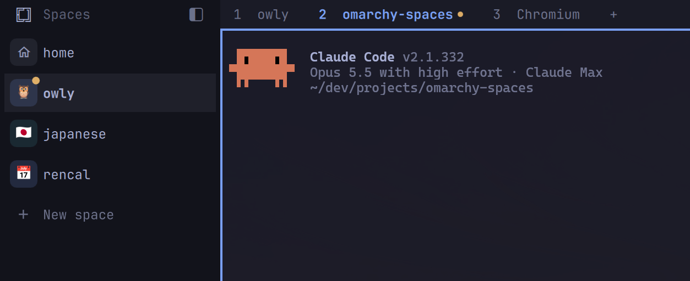

# Spaces for Omarchy

<p align="center">
  
</p>

A **space** holds one piece of work. Each space has its own **tabs**, and each tab is a workspace for whatever windows you like.

## Install

You need Omarchy 4.5 or newer.

**1. Add the plugin.** Press Enter when it asks where on the bar to put it.

```sh
omarchy plugin add https://github.com/t4t5/omarchy-spaces.git --enable
```

This also downloads the `space` command and links a file into your Hyprland config. A notification then asks whether Spaces should replace Omarchy's menu and workspaces on the bar. Nothing is lost if you say yes: the menu still opens with its key, or a right-click on the logo.

**2. Add the keys.** Put this at the end of `~/.config/hypr/bindings.lua`:

```lua
if package.searchpath("hypr.omarchy-spaces", package.path) then
  local spaces = require("hypr.omarchy-spaces")

  spaces.bind_tab_keys()
  o.rebind("SUPER + B", "Show or hide spaces", spaces.toggle_sidebar())
end
```

Omarchy's workspace keys now go to a space's tabs, and <kbd>Super</kbd> <kbd>B</kbd> expands the sidebar. There are [more actions you can bind](docs/guide/keys.md), such as opening and finding spaces.

To update or build from source, see [Installation](docs/guide/install.md). To remove it, see [Uninstall](#uninstall).

## Getting started

1. Press <kbd>Super</kbd> <kbd>B</kbd> to expand the sidebar, and click **New space**. It starts with a terminal in the folder you're in, and takes that folder's name.
2. Click the **+** on the bar to open another tab in it, and press <kbd>Super</kbd> <kbd>1</kbd>–<kbd>0</kbd> to go between tabs.
3. Click a space in the sidebar to go to it. Your plain workspaces are the `home` space, at the top.
4. Right-click a space or a tab to rename or close it, and drag to reorder.
5. Close a space's last window, and the space is gone.

A dot shows which spaces need you: **yellow** while an agent works, **red** when it's waiting for you, **green** when it's done.

## Docs

- [Spaces and tabs](docs/guide/spaces-and-tabs.md)
- [Keys](docs/guide/keys.md)
- [Configuration](docs/guide/configuration.md)
- [Command line](docs/guide/cli.md)

See [all the docs](docs/README.md) for the rest, including [how it works](docs/internals/architecture.md) and [developing Spaces](docs/internals/development.md).

## Uninstall

```sh
omarchy plugin remove com.t4t5.spaces
```

This moves your windows back to the plain workspaces, gives you back Omarchy's keys and bar, and removes the `space` command and your saved sessions. The keys you added to `bindings.lua` do nothing from then on, so you can delete them whenever you like.

## License

[MIT](LICENSE), except the sounds in `assets/sounds/`, which are Herdr's, under the [Apache License 2.0](assets/sounds/LICENSE).
